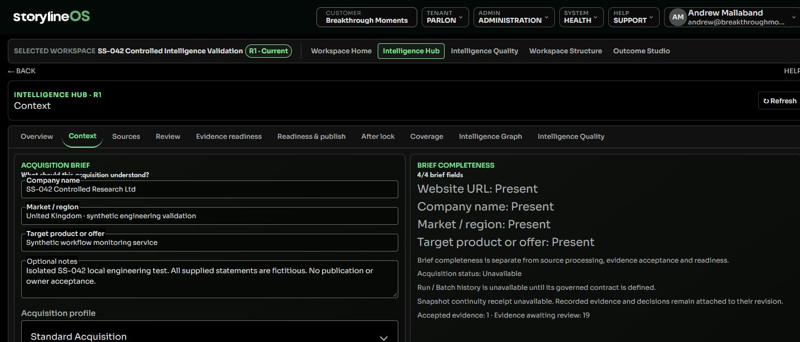

# Intelligence Hub Context

Context owns the acquisition brief, website URLs, document extraction and acquisition profile for the exact selected revision. Sources remains the provenance registry.

## Availability after lock

For a locked revision, Context and Workspace Structure show the same recording-availability check as [After lock](intelligence-hub-after-lock.md). It explains the prerequisites observed by the server or the reason recording is blocked. Checking, denied access and failed verification do not establish availability; a previous result cannot authorize a new action. Context offers a separate supplied-candidate form only when the current server check permits preparation and your signed-in recording identity can be verified. After lock separately supports saved-item inspection and authorised impact review/admission where its current server checks permit them. Workspace Structure shows revision relationships and each revision's own status. Acquisition stays disabled on the locked revision and its evidence basis stays unchanged.

## Submit separate evidence after lock

1. Check the selected locked workspace and the current recording-availability explanation.
2. In Separate post-lock submission, choose one UTF-8 JSON file of no more than 65,536 bytes. It must contain exactly source and evidence information in the supported submission format. Do not include a runtime binding, request key, actor or receipt.
3. Inspect the source, locator, retrieval/currentness, qualifications, licence, retention and provenance, together with the evidence statement. These are supplied assertions; importing the file does not independently verify the source or its content hash. No provider or document acquisition runs.
4. Enter why the evidence should be reviewed and select Submit for impact review. The application uses the current server binding, and the server checks authority, policy, storage and the locked basis again.
5. Inspect the immediate receipt in Context after the saved submission has been read back. Original recording: pending review means that this original intake remains outside the frozen evidence basis. It does not describe a later impact conclusion, admission or acceptance.

If the outcome cannot be confirmed, keep its submission and request references and use Check saved submission. This checks only the exact original request; it does not send another submission. A failed or missing readback does not establish that nothing was saved. A refresh or changed basis does not rewrite the retained command. Do not start another operation to resolve an uncertain outcome. Reopening receipt lists, impact review and successor admission are separate workflows and are not offered by this panel.

After the recording is confirmed, open [After lock](intelligence-hub-after-lock.md) in the same revision to inspect saved submissions and their later decisions. A stale-basis rejection saves no evidence through that rejected request: refresh the selected workspace and inspect the current basis before deliberately preparing another submission. A network error alone is an uncertain outcome, not proof of rejection.

## Prepare and acquire

1. Check the selected workspace and revision.
2. Enter the company name, market / region and target product or offer. Add relevant notes and website URLs.
3. Select supported documents and an available acquisition profile.
4. Use Build evidence or Refresh evidence when the current server-projected action and your authority permit it.
5. Inspect the resulting source contributions in Sources and make evidence decisions in Review.

PDF, PPTX, DOCX, TXT, MD and CSV are supported. Select up to five documents: 2.5 MB each, or up to 40 MB for PPTX. Originals are used for extraction and are not stored. Up to ten website URLs can be submitted. Strategic Acquisition is unavailable.

Further file selections add to the staged batch. An identical filename, type, size and content is included once; changed content under the same filename remains a separate input. Use Remove beside a staged document to remove that input, or Clear selected files to empty the batch. Cancelling the picker leaves the batch unchanged. An invalid, oversized or unreadable batch, or one exceeding five distinct files, leaves the previous valid selection available. Staging and removal are local preparation; they do not delete an acquired source or accept evidence.

Brief completeness measures four brief fields. It does not measure extraction success, evidence acceptance or publication readiness. Acquisition never silently accepts new evidence.

The source summary describes the complete selected revision, using the same basis as Overview and Sources. Documents processed counts each distinct current uploaded-document source once when a verified successful acquisition receipt matches its current content. A successful extraction with zero eligible evidence objects still counts once. Evidence-object totals, Run totals and brief completeness are separate measures. Older documents without verified receipt linkage are unknown; changed content with an older receipt is stale and excluded from the current processed count. Unknown processing proof makes the whole processed total unavailable, qualified by verified, unknown and stale counts.

Loading or a failed refresh hides the previous summary. Refresh the selected revision to obtain a current basis. A partial or unavailable processing summary does not mean extraction failed, nor does a successful extraction establish acceptance or readiness.

## Handle failure and changed data

A failed extraction shows its cause and request reference. Selected files and local edits remain available while switching Hub tabs in the same revision. Inspect the recorded Run outcome and refresh acquisition data before an explicit retry of a verified unsuccessful Run. That retry creates a new Run linked to its predecessor. A stale or failed refresh cannot unlock a retry. Include the request reference and Run identity when asking for support.

For document batches, inspect Latest document extraction for each input's outcome. A failed file does not discard the other files' successful extraction results. When acquiring websites and documents together, either type can retain successful results while the other reports failures. If every submitted document fails and no website succeeds, acquisition returns a failure. Enhanced acquisition still requires website evidence for its evidence-ready condition, even when document extraction succeeds. A supported document can extract readable text but produce zero eligible evidence objects; its extraction succeeds, and evidence sufficiency still needs a separate assessment. Blank or unreadable extraction fails. The list refers to the latest submitted inputs, while Sources shows retained source contributions.

When a website attempt fails, its verified prior source and evidence remain unchanged. Latest website acquisition shows the failed attempt separately from retained evidence. Other successful website or document inputs can still be saved. A later successful attempt replaces only that website's current extraction; changed content requires review again. Removing a URL from the acquisition brief removes it from future attempts and does not delete its recorded source or evidence.

If prior source, registry or evidence identities cannot be reconciled, acquisition reports a continuity conflict and preserves prior evidence without saving the new partial result. Refresh the current revision and inspect its source basis; include the request reference when asking for support. Do not interpret a continuity conflict as a successful refresh or a removal of prior accepted evidence.

When an error records actual extraction outcomes, inspect those separately from whether the revision was saved. An input can extract successfully, including with zero eligible evidence objects, while a continuity check prevents the result from being saved. A network or response failure alone does not prove whether a save completed. Use Check original acquisition request while the pending request is retained: it resends the exact original operation and request key, rather than starting a new operation with edited inputs. The server checks your current authority and returns the recorded result or an unresolved execution state. Do not start another operation while the outcome remains unconfirmed.

An active or unresolved Run does not prove failure or permit cancellation or retry. Refresh its selected receipt and contact support if it remains unresolved. Reloading, changing revision or changing login session clears local pending-request tracking and staged files; it cannot reconstruct the original document bytes. Use durable Run history to inspect what was recorded before staging another operation.

Discard local changes resets this draft; it is not a governed evidence reset. Switching revision replaces the draft context. If another operation changed the basis, refresh and deliberately reconcile your input before acquiring again.

## Locked and unavailable revisions

Locked acquisition is disabled. Inspect Sources or use the normal revision workflow for a permitted editable revision. Context does not create that revision automatically. If inputs or authority are unavailable, acquisition stays blocked; do not use another view to bypass the boundary.

When opened from an individual Graph inspection, **Return to graph inspection** restores that exact scoped object, mode, search and relationship page. The return is navigation only; Context does not acquire evidence, decide a finding or create a successor as part of that handoff. A mismatched or invalid return context does not offer the link.

Acquisition Run history records explicit operations in the selected revision. Batch is a display grouping; old attempts have no inferred Run. History entries are previews: open a Run to verify its receipt and use Refresh selected Run receipt to check that exact record. Its input outcomes, original basis and current or historical output describe execution, not evidence acceptance or readiness. Locked revisions retain Run inspection; new acquisition remains blocked. Checking a retained original request still requires current server authority.

Snapshot continuity receipts remain unavailable until their governed contract is connected. The existing acquisition workbench remains a recovery path while complete Context parity is being verified.

[Inspect Sources](intelligence-hub-sources.md) or [review evidence](intelligence-hub-review.md).

## Recorded illustration

This synthetic engineering example shows the Context brief and separate completeness and review counts. The values are fictitious and are not the current state of your workspace.

